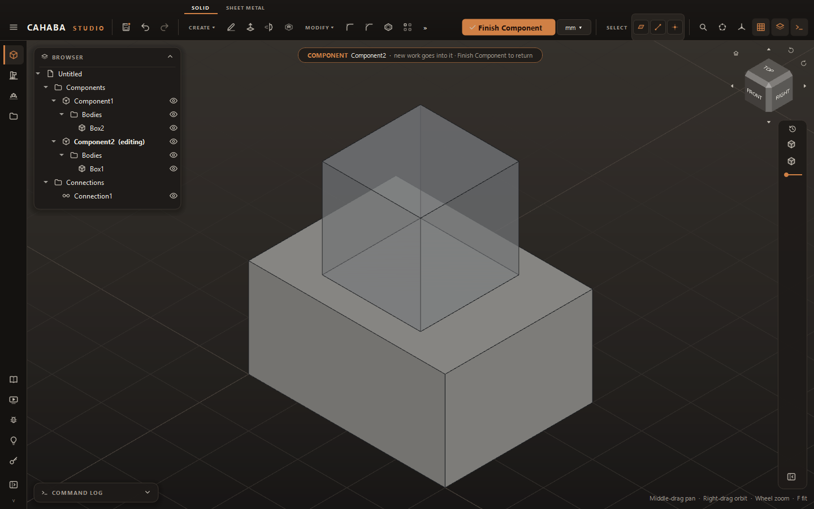

# Components and Instances

A **component** is a part definition; an **instance** is one placed copy of it. Change the
component and every instance changes. Use components for anything that appears more than once,
or to keep an assembly's parts separate.

## Make a component

1. Select the bodies that make up the part (in the browser or the view).
2. Choose **ASSEMBLE › Make Component**, or right-click a body in the browser › **Make
   Component**.

The bodies, their features, and any sketches and planes only they use move into the new
component. Its first instance stays where the bodies were. Rename the component in the browser
(++f2++) and its instances follow: **Base (1)**, **Base (2)**.

## In the browser

A component shows as a small document of its own:

- **Bodies**, **Sketches** and **Planes** folders for what it's made of.
- **Components** for other components placed inside it.
- **Instances**, with a count, listing every place it's put: **Base (1)**, **Base (2)**. An
  instance that sits inside another component says so, for example **Base (3) - in Bezel**.

## Hide and show

The eye beside a component hides all of it: every instance leaves the view, and everything under
it in the browser shows as hidden. Each instance and body keeps its own setting, so showing the
component again brings back what was showing before.

## Add more instances

Right-click the component (or one of its instances) in the browser › **Add Instance**. The copy
appears beside the others.

## Move an instance

1. Double-click the instance in the browser, or select it and choose **ASSEMBLE › Move Instance**.
2. Type how far to move it (**Move X**, **Move Y**, **Move Z**) and, optionally, an **Angle** to
   turn it **about** Z, X or Y (around the instance's own origin). Moves are relative to where it
   is now.
3. Click **Move**.

### Move several at once

Select several instances (Ctrl+click them in the browser or the view) and choose **ASSEMBLE ›
Move Instance**, or click more instances while the card is open. They move together as one: an
**Angle** turns the whole group around the first instance's origin, so they keep their places to
each other. It's one undo step. If any of them is grounded, none moves.

To place parts against each other exactly, use [connections](connections.md) instead.

## Ground an instance

Right-click an instance › **Ground** to fix it in place: connections never move it, and Move
Instance refuses to. Grounded instances show **⚓**. **Release** undoes it.

## Edit a component in place

1. Double-click the component in the browser (or right-click › **Edit Component**).
2. A banner shows you're editing it, and **Finish Component** appears in the top bar. New sketches,
   features and bodies now go into the component, and you can sketch on its faces and use the rest
   of the assembly for reference.
3. Click **Finish Component** (or double-click the component again) to return.

Every instance updates as you work.

## Subassemblies

A component can hold instances of other components, such as an axle with its two wheels. Place the
subassembly as many times as you need, and each copy moves as one.

To make one from parts already placed:

1. Select the instances, and any loose bodies that belong with them (Ctrl+click or Shift+click in
   the view or the browser).
2. Choose **ASSEMBLE › Make Component**, or right-click one › **Make Component**.

They go into the new component exactly where they are, and its first instance is placed so that
nothing moves. Connections between them go in with them. A connection from one of them to a part
that isn't going in is refused: select that part too, or delete the connection first.

To build one from the inside, edit the component (above) and add instances of other components
while you're in it. A component can't hold itself, or a component that already holds it.

In the browser, each copy inside a subassembly is listed under its own component, marked **in**
the subassembly. Parts lists count every part inside, however deep.

## Linked parts

A component can live in its own `.cb3` file and be used by several projects: a standard bracket,
a motor, a common enclosure.

- **Link a component to a file:** right-click it › **Link to File...** and choose where to save
  it. The component is now read from that file (its name shows **↗**).
- **Use a part that's already a file:** drag it from the [Projects panel](../getting-started/projects.md)
  onto the view, or right-click it there › **Insert into This Project**.
- **Use the changes:** after the part's file changes, choose **ASSEMBLE › Update Links**. When
  you open a project whose linked files changed or went missing, Cahaba Studio tells you. The
  project still opens with the last shape it had.
- **Bring it back into the project:** right-click › **Embed**.

A linked component can't be edited in place: open its own file to change it.

A project remembers where each linked part is from its own folder, so a folder holding a project
and its parts can be moved, zipped or copied to another computer whole. Renaming or moving a
linked part in the Projects panel updates the projects that use it.
