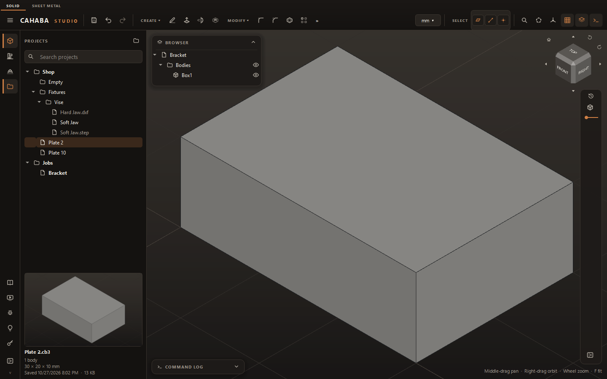
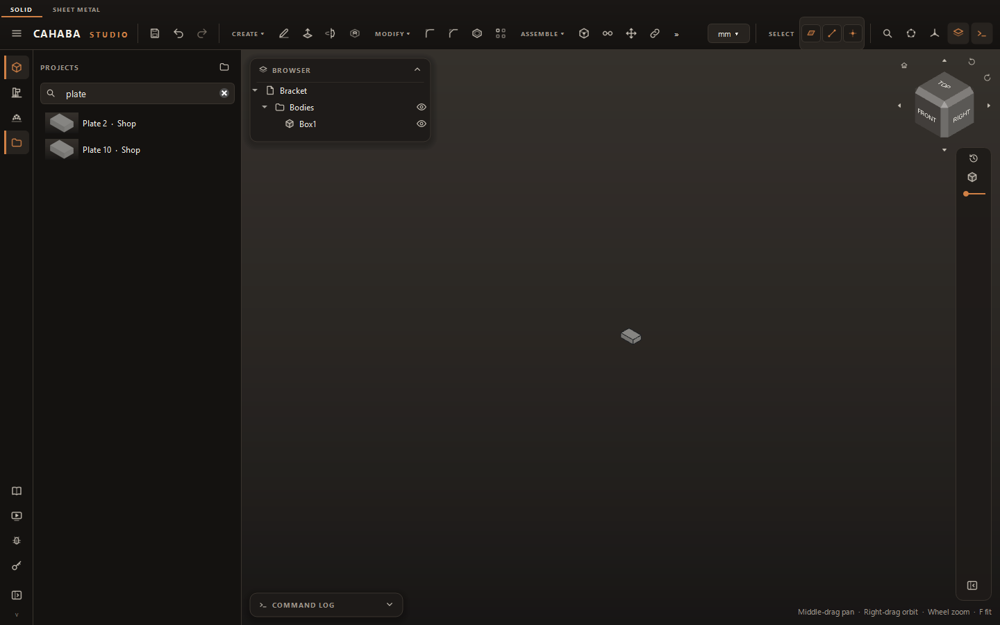
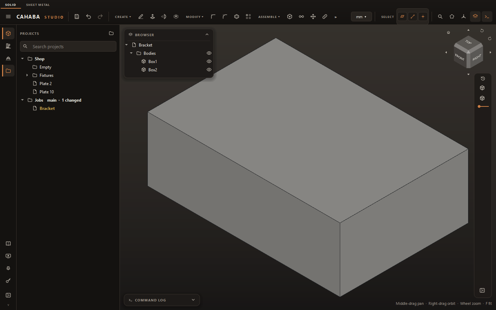

# The Projects Panel

The Projects panel shows the folders you keep your work in as a tree, beside the 3D view. Find a
part, see its picture, and open it without a file dialog.

Your files stay where they are. The panel is a view of ordinary folders on your disk: nothing is
copied or locked away, and anything you do to those folders in Explorer, or that OneDrive,
Dropbox or Git does, shows up in the panel on its own.

## Open the panel and add your folders

Click **Projects** in the sidebar, or press ++ctrl+shift+e++. The panel remembers whether you left
it open.

The first time, it's empty:

- **Add a Folder…** adds any folder you choose.
- **Use Documents\Cahaba Studio** makes that folder if it isn't there and adds it.

Add as many folders as you like, anywhere: the folder button at the top of the panel, or
right-click › **Add a Folder…**. Each one is a *location*. To take one off the list, right-click
it › **Remove from Projects**. The folder and its files are not touched.

## What the tree shows

Under each location: its folders, then its files.

- Cahaba Studio projects (`.cb3`, and `.ivc` from before the rename) are listed by name.
- STEP, STL, DXF, SVG, PDF and G-code files are listed in grey, so a project folder shows
  everything for the job. So are KiCad projects, boards and schematics.
- Other files, and hidden folders, are left out.

The project that's open is shown in **bold**.

| To | Do |
|---|---|
| Open a project | Double-click it, or select it and press ++enter++ |
| Open a drawing, a program or a KiCad file | Double-click it: it opens in whatever Windows uses for that kind of file |
| Bring a STEP, STL, DXF or SVG file into the open project | Right-click it › **Import into This Project**, or drag it onto the view |
| Make a folder | Right-click a folder › **New Folder…** |
| See a file in Explorer | Right-click › **Show in Explorer** |

When the panel is open, **Save As** for a new project starts in the folder selected in the tree.

## Pictures and details

Select a project to see its picture and what's in it: how many bodies, components and scans,
whether it has CAM, its overall size in the project's own units, and when it was saved.

The picture is taken when you save: the model from the Home view, fitted. A project saved before
version 0.9.6 has no picture until it's saved again.

## Search

Type in the search box to list matching files from every location, with the folder each is in.
Every word you type must match, in the file's name or in the name of a folder it's in.

## Rename, move, copy and delete

| To | Do |
|---|---|
| Rename a file or folder | ++f2++, or right-click › **Rename…** |
| Move it | Drag it onto a folder, or right-click › **Move to…** |
| Copy a file | Right-click › **Duplicate** (makes "Bracket copy" beside it) |
| Delete | ++delete++, or right-click › **Delete**. It goes to the Recycle Bin |

**Linked parts follow.** When you rename or move a part that other projects use as a
[linked part](../assemblies/components.md#linked-parts), those projects are updated to find it in
its new place, without you opening them. The same goes when an assembly moves away from its
parts, or a whole folder moves.

This reaches the projects inside your locations. A project kept somewhere else that links to a
part you moved will show it as missing: open it and choose **ASSEMBLE › Update Links**.

If other projects use a part you're about to delete, the question names them first.

## Put a part into the open project

Drag a project from the panel onto the 3D view, or right-click it › **Insert into This Project**.
It's placed as a linked part, named after its file, where you dropped it. Insert the same file
again and you get another instance of the same component.

A project that is itself an assembly can't be inserted: a linked part is one part.

(A project dragged in from Windows Explorer opens instead.)

## Versions

Every time you save over a project, the version before is kept (the last 10). Right-click a
project › **Versions** to see them by date:

- **Restore This Version** puts the project back to that version. What it was a moment ago is
  kept as a version too, so you can go back the same way.
- **Save as a Copy** saves that version beside the project as a file of its own.

Versions are kept by the project's name. Two projects with the same name in different folders
share one list, and a renamed project starts a new one.

## Keep a folder as a Git repository

If you use Git, a location can be a repository, to keep its history and push it to GitHub. This
uses the Git installed on your computer; if there isn't one, the menu says so.

1. Right-click the location › **Make This a Git Repository**.
2. Work as usual. Files you've changed since the last commit turn amber, new ones green, and the
   location shows its branch and how many files have changed.
3. Right-click the location › **Commit Changes…** and say in a few words what changed. The first
   time, Git asks for your name and email.
4. To send it to GitHub: make an empty repository on github.com, then right-click the location ›
   **GitHub Address…** and paste its address. **Push to GitHub** sends your commits; **Pull**
   brings in commits made elsewhere.

Signing in to GitHub is handled by Git itself, in its own window. Cahaba Studio never sees your
password.

Project files are binary, so two people's changes to the same project can't be merged. **Pull**
only succeeds when there's nothing to merge.
