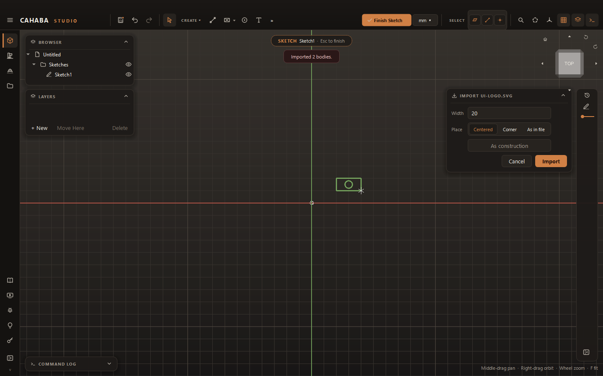

# Import and Export Drawings

## Import a drawing into a sketch

Bring in DXF, SVG, Illustrator (`.ai`) or PDF drawings, such as a logo, a panel layout from
another program, or a part outline.

1. Open the sketch to import into (or skip this to get a new sketch on XY).
2. Choose **CREATE › Import Drawing** and pick the file, **or** drag the file onto the view.
3. Set the import card:

    | Field | |
    |---|---|
    | **Width** | The drawing's width in your sketch. It starts at the drawing's own size; type a new width to scale it |
    | **Place** | **Corner** (its corner on the sketch origin), **Centered** (on the origin), or **As in file** (the file's own coordinates; the default for DXF). A dropped file is placed where you dropped it |
    | **As construction** | Import it as reference geometry only |

4. Click **Import**.

The drawing arrives as one **group**: click it to select the whole thing, drag to move it. Hold
++alt++ to drag a single point, or **Ungroup** it to work with the pieces.

### What comes in

- **Layers.** A DXF, Illustrator or PDF file's layers come in as [layers](layers.md) of the
  sketch, with their names. Hide the ones you don't need, or make them reference only so an
  extrude leaves them out.
- **Every artboard.** An Illustrator or PDF file with several artboards (pages) brings in all of
  them, set out in rows with an inch between them, the first at the top left. The file doesn't
  say how the artboards were arranged, so this may not match your layout.
- **Curves as they were drawn.** Straight sides come in as lines and corners stay sharp. A smooth
  stretch of curve comes in as one [Bezier path](drawing.md#bezier-paths), exactly as the file
  has it.

### Large drawings

A drawing of more than 300 curves comes in without constraints joining its ends. The ends still
meet, so its outlines still extrude; they just aren't tied together if you drag one. The import
says so when it happens.

A sketch with more than 1,500 curves is drawn in a fine line, so small details and lettering
stay readable.

Lettering saved as outlines can be tens of thousands of curves. It works, but the sketch gets
slow to hover and pick in. Hiding those [layers](layers.md) helps.

## Export a sketch

For laser cutters, plasma tables and routers (LightBurn, SheetCam, Vectric and similar):

1. Right-click the sketch in the browser.
2. Choose **Export as DXF...** or **Export as SVG...** and pick where to save.

| Layer | Contains | Color |
|---|---|---|
| **CUT** | The sketch's curves | Red |
| **ENGRAVE** | Text, and filled shapes, as closed outlines | Blue |

Each outline is written once. Colors don't make layers here; for a DXF with a layer per color,
set up for LightBurn, use the [DXF Builder](../making/dxf-builder.md).

If the sketch has [layers](layers.md), each is written as a layer of the file under its own name
and color, and hidden layers are left out: see
[Layers in exported files](layers.md#layers-in-exported-files).

Construction geometry is left out. Sizes are in your document's unit. DXF files are R12, which
nearly every program reads.

To export a **solid part** flat, with its outline, holes and engraving on separate layers, see
[Flat parts](../making/flat-parts.md).
